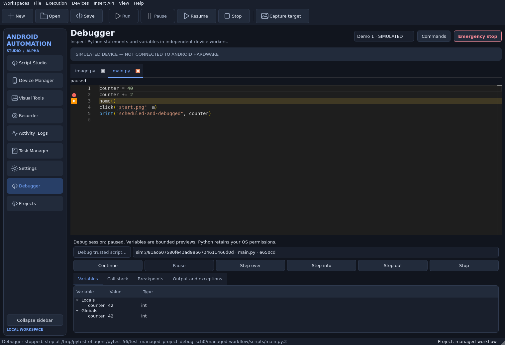
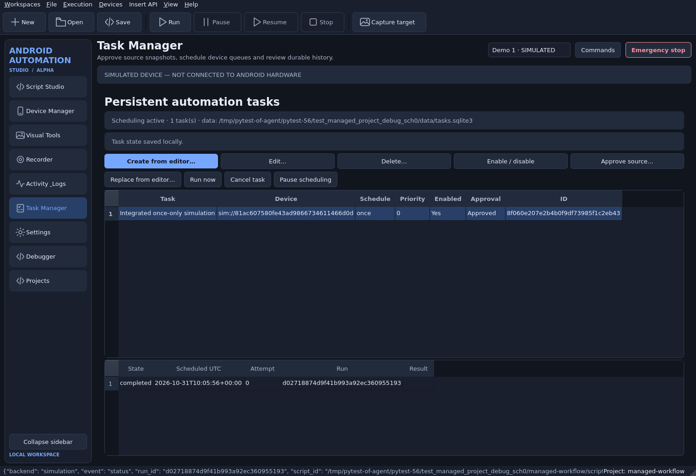
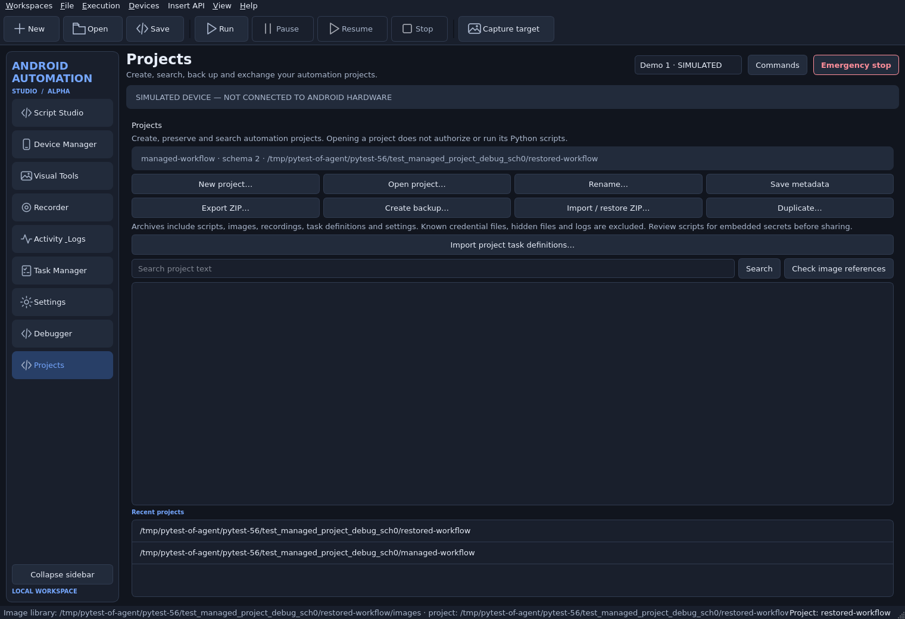

# Alpha development report — 2026-10-31

## Status and scope

Android Automation Studio remains **0.2.0 Alpha development**. This execution
implements substantial, usable portions of Phases 7–10. It does **not** close
every Alpha requirement or qualify as Beta. The major remaining product work is
listed in [KNOWN_ISSUES.md](KNOWN_ISSUES.md); Windows, real phones, redistribution
and sustained performance remain acceptance gates.

The new branch is `feat/alpha-completion`, based on the exact requested Phase 6
commit `0a3e65cb8b84c23ded1cff7c6a202183357087b9`. Initial checkout `work` pointed
to `099cc2a` and its fetch refspec tracked only main. Explicitly fetching Phase 6
resolved that configuration issue. No implementation was based on the older
checkout, and main/preceding development branches were not changed.

## Implemented and preserved

| Milestone | Actual delivery | Remaining acceptance/scope |
| --- | --- | --- |
| 1 — baseline and startup | Pristine Phase 6 suite: 687 passed, including 12 GUI journeys; all 105 pinned Monaco files verified; missing/corrupt/symlink rejection; AMD guard, timeout and failure latch; cached verified repair/download; dependency health in GUI/CLI | User's restricted school host still needs its own diagnostics; no remote USB permission repair claimed |
| 2 — Phase 6 continuation | Existing three simulator scenarios, matching/preprocessing/scales/OCR, image inspector, capture and recorder retained; recorder v3 preserves elapsed timestamps and metadata through edits/reorder/save/load | Physical touch recording, arbitrary multitouch and universal recognition accuracy are not claimed |
| 3 — debugger/recovery | Real per-worker `bdb` line breakpoints, enable/disable, pause/continue/step into/over/out, stack/locals/globals, exceptions/output, immutable source hashes, per-tab breakpoint identities, bounded hook-free inspection; bounded read-only recovery/checkpoints; SQLite failure history and opt-in fresh post-failure screenshots | Main-script breakpoint scope; read-only console; native-call pause delays; no serialized Python-stack recovery |
| 4 — tasks | SQLite v1 tasks/history/transactions, manual/once/interval/daily/weekly timezone schedules, priority/dependencies, missed-run policy, duplicate decision protection, timeout/cancel, bounded explicit safe restart, independent serial queues and native Task Manager | Groups, visual DAG authoring and multi-instance coordination deferred; interrupted external actions remain uncertain |
| 5 — projects/UX | Managed project v2, create/open/save/rename/recent/search/missing-image checks, migration backup, guarded ZIP export/import/restore, duplicate, atomic conflict-checked metadata, saved task definitions imported disabled/unapproved; real Debugger/Projects/Tasks workspaces | Complete autosave recovery/configuration editors/deletion UX deferred; dirty buffers must be saved before export |
| 6 — release groundwork | Resource discovery, pinned timezone data, Windows PyInstaller one-folder/portable ZIP/checksum tooling, per-user Inno recipe, GUI/worker smoke and Windows CI jobs, diagnostics reports, license/security documentation and actual Linux simulator benchmark | No Windows runtime, portable ZIP or installer was created here; licensing/signing/clean-machine acceptance pending |
| 7 — integration | Native-dialog project → capture → Monaco gutter/debug → recorder-generated Python → scheduled actual worker → history → archive/restore → restart workflow; regression/security/safety tests and reviewed screenshots | GitHub API access prevents observing remote CI and creating the requested draft PR in this session |

Preserved architecture: Python 3.12, PySide6/WebEngine/QWebChannel/Monaco, ADB and
scrcpy 3.1 transport, PyAV decoding, OpenCV/NumPy, optional local OCR, the existing
scripting API, isolated spawned workers, serial/generation routing, native trust
approval and emergency stop. No application rebuild or replacement frontend.

Important implementation paths:

- `app/editor/assets.py`, `widget.py`, `bridge.py`, `editor_web/` and
  `tools/fetch_monaco.py`: offline validation/readiness and document identities.
- `app/health.py`, `app/main.py`, `tools/setup.sh`: supported local diagnostics,
  native import probes, storage/cache guidance and non-destructive setup.
- `app/automation/debugger.py`, `runtime.py`, `qt_service.py`: owned debugger
  lifecycle composed with existing tracing, leases, cancellation and activation.
- `app/automation/recovery.py`, `recovery_journal.py`, `recording.py`: bounded
  observation retry, checkpoint validation, durable evidence and timestamps.
- `app/tasks/`, `app/projects/management.py`, and their native UI panels:
  versioned persistence and project/task workflows.
- `app/ui/window.py`, `shell.py`, `script_studio.py`: real workspace wiring,
  generation-bound approval, source navigation and shutdown integration.
- `packaging/`, `tools/build_windows.py`, `.github/workflows/alpha-tests.yml`:
  Windows delivery recipes and platform test gates.

## Debugger, recovery and security

The debugger uses established Python `bdb` machinery rather than a DAP adapter.
This avoids a second tracing owner/adapter process and dependency while providing
the tested line/step/stack behavior. Private inherited JSON pipes expose no TCP
listener; this is not a DAP implementation. Commands and snapshots are bounded.
Inspection bypasses user `__repr__`, metaclass name descriptors and expression
evaluation. Variables remain in the inspector instead of general activity logs.

Every worker owns its device context and debugger. Pausing one leaves other
workers and the Qt loop running. Stop while paused, API-wait pause, stdlib imports,
handled exceptions and source-file edits are exercised by actual process tests.
Breakpoints/source decorations are associated with the approved snapshot and
host tab identity. Editing source never changes the running code.

Read retries allow only built-in observation methods and typed transient failures.
Inputs and lost transport acknowledgments are never inferred safe to repeat.
Whole-script scheduler restart requires separate explicit safety approval and a
bounded retry policy. Device loss/reset invalidates approval and queued work.
Native trust dialogs revalidate connection tokens after their modal event loop.
Corrupt task/failure databases are preserved; those features display unavailable
while editing continues. Opt-in screenshots are fresh **post-failure** evidence,
not a claim about the exact failed instant, and are omitted if the connection or
active run changes.

Trusted Python still has the current user's OS permissions, including imports,
files, processes and networks. Worker isolation is not a sandbox or containment
for arbitrary descendants. Imported helper modules/assets are mutable project
files. No script is automatically authorized by opening/importing a project.
See [SECURITY.md](SECURITY.md), [DEBUGGING.md](DEBUGGING.md),
[RECOVERY.md](RECOVERY.md) and [TASKS.md](TASKS.md).

## GUI evidence

Actual headless Linux Qt/WebEngine screenshots, reviewed during this execution:







Available workspaces: Script Studio, Device Manager, Visual Tools, Recorder,
Activity & Logs (runs/output and failure history), Task Manager, Settings,
Debugger and Projects. The debugger reuses the real Monaco tabs beside native
inspection controls. Existing light/dark themes, compact navigation, preview,
command search and emergency stop remain available. New screenshots show the
large desktop layout; real Windows high-DPI/multiple-monitor acceptance is pending.

The integrated probe drives native Qt file/input/trust dialogs and an actual
Monaco gutter mouse click. It captures a real simulator PNG, stops at a breakpoint
with `counter == 40`, steps to `42`, continues to change the simulator screen,
records Home/tap controls, saves the session, inserts editable generated Python,
schedules that source in an actual worker, verifies completed durable history,
exports/restores saved assets/scripts/recording/tasks, and restarts the workbench.
Restored schedules remain paused/unapproved and do not recreate a simulated phone.
Failure probes separately cover missing targets/timeouts, cancellation,
unavailable connections, stale modal approvals and corrupted persistence.

## Validation evidence and platform limits

The final exact suite counts are recorded in
[alpha-tests.json](validation/alpha-tests.json); categories overlap and must not
be summed. The pristine baseline ran separately from implementation edits:
**687 passed, 0 failed, 0 skipped in 48.81 seconds**.

**Final regression: 863 passed, 0 failed, 0 skipped in 79.68 seconds.** This
includes all 23 GUI-marked real Qt/WebEngine journeys and preserves the original
687-test suite. The final run regenerated the screenshots above. Dedicated test
module counts and all GUI case identifiers are retained in the JSON report.

| Category | Executed result |
| --- | --- |
| Full suite | 863 passed / 0 failed / 0 skipped |
| Real GUI journeys (subset of full suite) | 23 passed |
| Dedicated simulator module | 8 passed; additional GUI/task/recovery tests also exercise actual simulation |
| New debugger core + GUI modules | 9 + 1 passed |
| New scheduler core + GUI modules | 23 + 1 passed |
| New project preservation module | 40 passed, plus tab and integrated GUI journeys |
| Windows runtime tests | 0 — NOT VERIFIED |
| Physical Android tests | 0 — NOT VERIFIED |
| Separate measured worker performance scenarios | 3 passed: 1, 2 and 4 devices; not additional pytest cases |

Final command, using sandbox-disable flags only for isolated cloud Chromium IPC:

```bash
STUDIO_GUI_TESTS=1 QT_QPA_PLATFORM=offscreen \
QTWEBENGINE_DISABLE_SANDBOX=1 QTWEBENGINE_CHROMIUM_FLAGS=--disable-gpu \
STUDIO_CONFIG_DIR=/tmp/aas-final-config STUDIO_DATA_DIR=/tmp/aas-final-data \
.venv/bin/python -m pytest -q --junitxml=/tmp/aas-alpha-final-tests.xml
```

Do not put these Chromium flags in a normal desktop launcher. Earlier integration
runs found legacy editor test-double API omissions and a native-file-dialog test
driver race (the asynchronously loaded directory retained `script.py`). The
test driver now enters the visible filename after the directory event loop.
Code review additionally fixed shutdown timer lifetime, stale dialog/session
approval, per-tab debugger mapping, variable log exposure, metaclass inspection
side effects and Windows timezone data availability.

Additional actual evidence:

- [Dependency health](validation/alpha-health.json): required native imports,
  Monaco files, pinned scrcpy server and ADB version checked; `adb devices -l`
  succeeded with **zero physical devices**.
- [Source release smoke](validation/alpha-source-release-smoke.json): real
  workbench/Monaco plus spawned simulator worker passed on Linux; `frozen:false`.
- [Worker measurements](validation/alpha-workers-performance.json): one/two/four
  distinct worker PIDs completed image matching and state changes in respectively
  0.2408/0.3354/0.6902 seconds on the recorded Linux five-logical-CPU environment.
  These are short fixture measurements, not sustained throughput guarantees.
- Locked dependency sync, compilation and whitespace checks were executed.

Windows tests executed here: **0**. Physical Android tests executed here: **0**.
No Windows portable ZIP/installer artifact exists from this execution. CI YAML
is implementation, not proof of a remote Windows pass. CPU/RSS/streaming FPS and
long-running leak tests remain unmeasured; see [PERFORMANCE.md](PERFORMANCE.md).

## GitHub delivery and next actions

Repository: <https://github.com/MD7-1337/Bot_Frm>. PR base:
`feat/phase6-recognition-simulator`; head: `feat/alpha-completion`. No mainline
merge, force-push or preceding-branch modification is authorized or performed.
The environment configuration was not edited or published.

GitHub CLI authentication/API access returned `Forbidden`; a draft PR and remote
Windows CI result cannot be claimed. The prepared PR description is
[PULL_REQUEST_ALPHA_COMPLETION.md](PULL_REQUEST_ALPHA_COMPLETION.md). Publishing
outcome and final commit hashes are reported in the chat delivery message.
Comparison URL:
<https://github.com/MD7-1337/Bot_Frm/compare/feat/phase6-recognition-simulator...feat/alpha-completion?expand=1>.

Next engineering work: complete the autosave/project configuration and group/
workflow UX, expand debugger source snapshots where needed, run sustained
performance/cleanup tests, review licensing, then observe the Windows CI build
and test clean-machine portable/installer behavior. The user should run
[HARDWARE_ACCEPTANCE.md](HARDWARE_ACCEPTANCE.md) on an authorized Windows/Android
setup. The school-computer connection problem still needs local evidence; an
empty ADB list does not establish an application defect. Only after those gates
and remaining usability/scope work should Alpha completeness or Beta be assessed.
