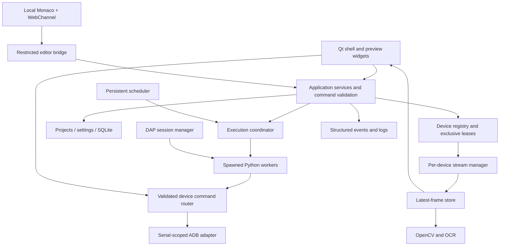

# Android Automation Studio — engineering blueprint

Version 0.1 · 2026-10-29 · targets Windows 10/11 x64

Current GUI/recognition/recorder increment: [DEVICE_MANAGER_VISUAL_TOOLS.md](DEVICE_MANAGER_VISUAL_TOOLS.md).
Device Manager and Visual Tools now have visible navigation, with an initial
studio-control recorder and explicit multi-scale matching. Hardware/Windows,
full recorder, OCR and other later acceptance gates remain outstanding.

2026-10-30 update: the foundational scripting API, pause/resume and editor API
assistance are now implemented. Their actual contract is in
[SCRIPTING_API.md](SCRIPTING_API.md) and evidence in
[SCRIPTING_ENGINE.md](SCRIPTING_ENGINE.md). This blueprint's broader proposed
API still includes later features; it does not override the implemented contract.

Implementation update: the device/video/capture foundation now includes a pinned
scrcpy transport and decoder. See [STREAMING.md](STREAMING.md) and
[DEVICE_INTEGRATION.md](DEVICE_INTEGRATION.md) for current evidence. Hardware
acceptance gates remain open; this blueprint's target architecture is unchanged.

This is the design baseline for the user's version 2.0 specification. The first deliverable is **Phase 0: architecture and technical proofs**, not the finished application. A module's presence does not establish release readiness. Runtime test results belong in the repository's validation report; this document describes intended behavior and acceptance gates.

## 1. Requirements audit

The confirmed stack is Python, PySide6 Widgets, Monaco in Qt WebEngine, QWebChannel, ADB, scrcpy-based streaming, OpenCV, offline OCR, SQLite, debugpy, and managed Python workers. Android devices run the target applications; the Windows host runs the IDE. Root, internet access, and cloud accounts must not be core requirements.

| Specification sections | Coverage and ownership | Delivery phases |
| --- | --- | --- |
| 1–2: mission, product boundaries | Desktop control center; real devices; independently progressing scripts; sequential apps per device; explicit limitations | All; product gates in 10 |
| 3: technology rules | Pinned runtime/editor; modular Python; local editor resources; restricted bridge; redistribution review | 0, 3, 10 |
| 4: eighteen subsystems and messages | Module boundaries and event contracts below | 0; expanded at each phase |
| 5: full GUI and customization | Four workspaces; Qt docking; presets; accessible commands; themes, layouts and shortcuts | Foundation 1; completion 9 |
| 6: device manager | USB, Wi-Fi connect/pair; serial identities, names/groups, status/metadata, individual/group actions, authorization handling | 1–2, 5 |
| 7: embedded previews and control | Decoded shared frames; fit/zoom/rotation transforms; overlays; detach/grid; managed external and screenshot fallbacks | Proof 0; hardware gate 2 |
| 8: Monaco and hybrid references | Offline editor; tabs, diagnostics, completion, signature/hover, search, breakpoints, source line; image decorations without modifying source | Proof 0; 3, 7 |
| 9: capture and image editor | Capture, crop, coordinate/target offsets, variants/metadata, library, match tester | 2–3, 6 |
| 10: recognition | Templates, scales, regions, preprocessing/NMS; OCR/languages; pixel/color; optional UI hierarchy; explicit fallback policies | Core 4; advanced 6 |
| 11: scripting API | Bound and explicit-device styles; typed contracts, errors, cancellation, wait overloading | Subset proof 0; full 4–6 |
| 12: recorder | Record only actions routed through controlled previews; editable timeline; Python generation/replay | 6 |
| 13: multi-phone execution | Shared-source independent workers; distinct sources; bounded processes, lease arbitration, independent errors, group stop | Proof 0; 5 |
| 14: debugging | Per-run DAP, breakpoints/stepping/variables/stack, recognition inspector, always-accessible emergency stop | Runtime stop 0/4; debugger 7 |
| 15: tasks and games | Persistent priorities, dependencies, queues, schedules, repetitions, duration/retry limits, sequential package workflows | 8 |
| 16: recovery | Typed failures, bounded retries/backoff, checkpoints, state verification, screenshot evidence; no blind replay after disconnect | Errors 0/4; policies 7–8 |
| 17: projects | Portable source/assets; CRUD/autosave/search/templates; backup/history/import/export/migration; optional Git | Basic 3; full 9 |
| 18: scale and performance | Shared bounded frames, background FPS, resource profiles, region recognition, measured metrics; no promised device count | Budgets 0; measurements 5/10 |
| 19: security and privacy | Trusted script confirmation, permission declarations, bridge/IPC validation, device leases; offline privacy and retention; no sandbox claim | All; audit 10 |
| 20: settings | General/device/video/automation/editor/debug/performance/security/update categories; validated import/export/defaults | Infrastructure 1; completion 9 |
| 21: logging and diagnostics | Structured correlated logs; filters/export/redaction; dependency/connection diagnosis, crash and failure reports | Foundation 0–1; full 7/10 |
| 22: installation and updates | Portable + installer; bundled offline dependencies; first run, verified optional updates, preservation and rollback | Evaluation 0; release 10 |
| 23: source organization | Responsibility-oriented packages; avoid empty abstractions and circular UI dependencies | 0 onward |
| 24: phased roadmap | Ordered gates in PHASES.md; integrate before adding the next subsystem | 0–10 |
| 25–26: testing and acceptance | Unit/integration, actual Qt proof, emulator/hardware and clean-Windows tests; implementation + persistence + errors + docs | Every phase |
| 27: documentation | Architecture/ADRs now; phase-specific runnable tutorials as features exist; installation, developer, release and troubleshooting guides | 0 onward |
| 28: final deliverables | Twenty deliverables are the release inventory, not a claim about Phase 0 | Release gate 10 |
| 29–30: execution rules and first task | Blueprint first; coherent real proofs, tests, evidence, limits, next tasks; preserve existing implementation | 0 onward |

### Resolved ambiguities and constraints

- "Complete product" is the ultimate objective. The explicit first task is blueprint plus Phase 0; a test shell is a technical proof and must be labeled accordingly.
- Multiple apps on one phone means foreground app switching with ordered tasks. It does not imply two foreground games run simultaneously.
- Monaco supplies an editor, not a Python language server. Syntax parsing/API suggestions are an initial subset; project-wide Python intelligence needs a separate language-service adapter.
- Screenshot polling can prove embedded capture/rendering and input coordinates. It does not prove low-latency scrcpy streaming or release performance.
- ADB commands always name a serial. Display aliases never replace the verified identity in transport calls.
- Scripts have ordinary Python host permissions. A confirmation dialog, an `exec` namespace, and a separate process are not a security sandbox. Untrusted scripts must not be run.
- Process termination can stop future dispatch but cannot reverse an Android command already sent. A host cannot guarantee another program will not independently control the same ADB serial.
- "20 or more devices" is an optimization target conditional on measured host, USB, transport and phone capacities. It is not an acceptance promise at an invented FPS.
- Android UI hierarchy/OCR availability and Unicode injection vary by app/Android version. Unsupported features must report that limitation rather than invent results.
- Portable data does not mean portable secrets or automatic trust: imports start untrusted, hashes invalidate approvals after source changes, and exports omit secrets.

## 2. Architecture and module boundaries



This table is the target architecture. The initial source intentionally uses smaller packages, including `app/vision` for the recognition proof; move code only when responsibility growth justifies it. The production boundary is a local application, not an HTTP service. GUI widgets own presentation only. All device subprocess work, recognition, disk-heavy imports, and debug communication stay off the GUI thread. Qt queued signals deliver immutable results to widgets. Workers never call Qt objects.

| Package / subsystem | Responsibility and public boundary |
| --- | --- |
| `app/main.py`, bootstrap | Dependency/config initialization, QApplication lifetime, `freeze_support`, startup diagnostics, shutdown order |
| `app/ui` | Main window, dock/layout navigation, reusable preview/log/action widgets, notifications and accessibility |
| `app/editor` + `editor_web` | Editor lifecycle, source snapshots, validation, local Monaco assets, constrained bridge, language-service adapter and image reference decorations |
| `app/devices` | Discovery/connection, verified serial registry, metadata, user aliases/groups, ADB argv construction and device status errors |
| `app/streaming` | Capture/stream transport, decode, latest-frame mailbox and coordinate transforms; no widget dependencies in transport |
| `app/automation` | Bound API, worker process lifecycle, run state, vision/OCR adapters, recording, debugger and bounded recovery policies |
| `app/scheduling` | Persistent scheduling, dependency validation, due-run selection, lease requests and missed-run policy |
| `app/projects` | Safe relative paths, atomic source/assets, project manifests, backups, import/export/migration and source diagnostics |
| `app/storage` | SQLite repositories and transactions; no widgets or device operations |
| `app/security` | Trust approvals, source digests, permissions for built-in services, diagnostics redaction and update verification |
| `app/diagnostics` | Contextual logs, bounded retention, real metrics, dependency probes and explicit support exports |
| `app/updates`, `packaging` | Verified manifests/install staging, recovery, PyInstaller specification and installer sources |

Only packages needed by the current phase should be created. The full map does not require placeholder implementation files.

### Event and command contracts

Production messages have a versioned, validated envelope. Use JSON-compatible primitives across trust boundaries, explicit size/depth limits, bounded queues, finite numbers and allowlisted event kinds. Never accept arbitrary pickle, callable names, Python expressions, or filesystem paths from the web page. A process transport being local is not a substitute for validation.

```json
{
  "schema_version": 1,
  "kind": "run.status",
  "event_id": "uuid",
  "occurred_at": "2026-10-29T12:00:00.000Z",
  "run_id": "uuid-or-null",
  "device_serial": "verified-serial-or-null",
  "payload": {"state": "running", "sequence": 4}
}
```

| Kind | Typed payload / invariant |
| --- | --- |
| `device.changed` | serial, observed state (`device`, `offline`, `unauthorized`, `disconnected`, `unknown`), optional metadata; unknown fields remain null |
| `frame.available` | serial, frame ID, capture monotonic timestamp, width/height, orientation, buffer handle; never put full video frames in the reliable event queue |
| `control.request/result` | request ID, lease generation, serial, allowlisted action and validated parameters, deadline; match every response to its request |
| `run.request/status` | immutable source digest/path, asset root, serial grants, trust decision, run ID; state and terminal reason |
| `recognition.result` | frame ID, method, matches with original-device bounds, score and elapsed milliseconds; score is not a probability |
| `debug.event` | run ID, session ID, DAP sequence and validated debugger event; loopback endpoint is private to that run |
| `failure/recovery` | error code, safe message, source location, optional evidence ID, attempt count and policy decision |
| `task.changed` | task/run IDs, old/new state, trigger ID, due UTC timestamp; transactional state change |
| `metrics.sample` | measurement window, CPU/RSS/FPS/latency/queue depth where observed; unavailable values null |

Reliable run/error transitions cannot be dropped. High-frequency frames and telemetry use latest-value mailboxes or coalescing. Log saturation drops low-priority entries with an explicit drop count; it cannot deadlock a worker or hide its terminal outcome.

## 3. Technology specification

The initial proof targets Python **3.12** with **PySide6 6.8.3**, **Monaco 0.52.2**, **NumPy 2.2.4**, **opencv-python-headless 4.11.0.86**, and **pytest 8.3.5**. The repository manifest/lock files are the executable dependency source. A pin is a reproducibility decision, not a statement that the package has no security advisories. Patch upgrades require bridge, decoding, packaging, and offline regression tests.

- Qt Widgets/QDockWidget avoids a second UI stack. Qt WebEngine is a large Chromium-based dependency with separate subprocess/resources, GPU and OS compatibility requirements; test on supported clean Windows machines.
- OpenCV's headless wheel avoids a second Qt distribution and plugin conflicts. Decode screenshots once into a defined color order; copy only when a consumer needs ownership.
- Monaco is retrieved and integrity-checked during development/setup and bundled locally. Node/npm is build tooling only; release users do not install it.
- scrcpy **3.1** is an experimental protocol baseline to investigate, not an interchangeable client for arbitrary server versions. Pin client/server together once the hardware experiment succeeds. Do not silently upgrade either half.
- Evaluate PyAV for H.264 decoding from scrcpy server packets. Add it only when the streaming experiment justifies it and exact Windows wheels, FFmpeg configuration and licenses are recorded.
- Evaluate offline **Tesseract 5** via a bounded subprocess/TSV adapter first. It avoids a heavy always-on ML runtime. Bundle only approved language models; validate tiny game fonts, scale, latency and multilingual fixtures before choosing it as the release engine.
- Use **debugpy** through DAP for production debugging. Pin a tested version in Phase 7. Debug sessions require one worker endpoint each; an unauthenticated public debug port is prohibited.
- Use standard-library SQLite, JSON, pathlib, logging and multiprocessing where appropriate. Avoid server infrastructure and unnecessary services.
- Evaluate **PyInstaller on Windows** for a directory-based portable bundle and **Inno Setup** for the installer. Linux cannot produce a verified Windows distribution merely by creating a spec file.

The license and compatibility review is in DECISIONS.md. No installer, executable, hardware compatibility matrix, or benchmark is claimed here.

## 4. Embedded scrcpy plan

### Primary path to prove

1. Resolve an authorized device by exact ADB serial and acquire its session.
2. Start the matching pinned scrcpy server through that device's ADB transport. Own temporary files, sockets, forwarding rules and server process as a session; never kill unrelated ADB sessions.
3. Establish the version-specific video/control channels. Parse and bound the official protocol's handshake, codec metadata and packet sizes. Treat disconnect/short reads as errors. Do not implement an unverified guess at the binary protocol.
4. Decode H.264 with a maintained decoder into immutable frame buffers. Retain original pixel dimensions and presentation/capture timestamps. Decoder output feeds one bounded latest-frame store per device.
5. A Qt rendering widget consumes the latest frame on the GUI thread, using a controlled-lifetime QImage or owned copy. Recognition consumes a read-only view of the same frame, with freshness deadlines.
6. The control adapter serializes pointer/key actions to the correct session. Pin its protocol with video. Release held inputs on cancellation where supported.
7. Reconnect only to an explicitly verified device state; stop the task pending recovery confirmation when action completion is ambiguous.

Validate changing orientation, resolution, codec reconfiguration, suspend/resume, USB disconnect, two phones, and repeated close/reopen. Benchmark latency, CPU/RSS and frame drops on recorded hardware before claiming acceptable stream performance.

### Coordinate contract

Device coordinates use screenshot pixel space with origin at the top left. Preview coordinates are widget logical pixels. Rendering records content rectangle, clockwise display rotation, zoom, pan and device pixel ratio; input uses the inverse transform of the exact rendered frame. Reject clicks in letterboxes rather than clamp them onto the phone. Use pixel-center conventions and test boundary points for every rotation. A new orientation invalidates gestures begun on an obsolete frame. Crop rectangles are normalized and clipped only after user confirmation, not silently applied as a device action.

Overlay items live in a separate paint layer and reference frame IDs. They never modify raw screenshot pixels. Detach/fullscreen changes only the view and transform, not the transport.

### Available fallback and honest status

An `adb -s SERIAL exec-out screencap -p` transport can populate an embedded preview and exercise capture/coordinates with low-frequency screenshots. The initial UI requests one capture per second, with at most one in flight; this is a timer setting, not a measured guaranteed FPS. It is slower than video and must be labeled **ADB screenshot fallback**. Polling has one in-flight capture and latest-only results to avoid accumulating stale work. Each command has a timeout.

A managed external scrcpy process uses explicit `--serial` and lifecycle cleanup. An external window is a fallback, not embedded streaming. Phase 0 can verify argv construction, process handling, transforms and synthetic frames without phones. Actual launch/control, embedded H.264 streaming and two-phone behavior remain hardware gates until exercised with authorized devices.

## 5. Monaco integration plan

The packaged page loads only application-owned Monaco files, Qt's QWebChannel transport and local resources. The page must not browse external sites, run remote scripts, request arbitrary files or spawn Python. WebEngine navigation is restricted to the editor entry point; new windows/downloads and remote requests are denied. Host dialogs own file selection and execution approval.

The bridge supports small document operations: editor ready, source changed/snapshot, diagnostics, insertion, selection and cursor updates. Each operation has validated types/size and a document/revision ID. The Python backend decides which file a document ID represents. There is **no** generic `eval`, `exec`, arbitrary command, path-open, or device-control bridge method.

Initial proof: instantiate QWebEngineView, load local Monaco offline, exchange Unicode Python text through QWebChannel, parse it for syntax errors without executing it, return diagnostics, and insert a valid snippet. Test the actual embedded Chromium runtime; a JavaScript lint pass does not prove the bridge works.

Later editor features:

- Monaco's Python tokenizer supplies syntax coloring, folding, bracket matching and base editing. Register documented built-in API completions/signatures/hovers from a single versioned API catalog.
- A separate language adapter provides project-aware completion, import/type analysis and diagnostics. Evaluate a Python-native service (for example Jedi for completion) plus a type checker, versus an optional packaged language server. Do not require a separately installed Node runtime at application runtime without an explicit decision. `ast.parse` proves syntax only, not full Python intelligence.
- Debounce source snapshots, discard diagnostics for stale revisions, and preserve all tabs/unsaved buffers separately. Atomic save writes plain UTF-8 `.py`; external edits require conflict handling.
- Parse image references from Python syntax; resolve only relative to the current project asset root. Decorate ranges with missing-image warnings and hover thumbnails. Cache by asset digest/mtime with size limits and invalidate on file changes.
- Image previews use a safe resource resolver or bounded encoded thumbnail, not unrestricted file URLs. Clicking a decoration opens the host's image editor. Decorations never replace string literals or mutate saved source.
- DAP adapters map source coordinates to Monaco decorations for breakpoints and the executing line. Decoration state is separate from source content and per run.

## 6. Automation runtime design

Use Windows-compatible `multiprocessing` **spawn**, never fork an initialized Qt/WebEngine process. `if __name__ == '__main__'` and frozen executable support are mandatory. The coordinator limits active workers and launches one independent context per device/run. A shared source assigned to three phones creates three contexts; its globals, asset resolution, logs and failure status are independent.

A run context contains run ID, assigned verified serial, explicit additional serial grants, project root, source digest, cancellation/pause primitives, API instance and policy defaults. The simple API is bound to that context, not a mutable global "current phone". `devices.get(...)` cannot steal another active run's device; explicit cross-device access must be declared and leased atomically to avoid deadlocks.

Production actions go through one per-device router. Manual preview control, scripts and scheduled tasks all request the same lease; while automation owns a phone, manual input is disabled or requires an explicit pause/takeover. This protects coordination within this application; it cannot prevent external ADB programs from issuing commands.

State machine:

```text
created -> starting -> running <-> paused
                     running -> completed
                     running -> failed
starting/running/paused -> cancelling -> cancelled
unexpected exit -> failed (worker_crash)
```

A bounded request/reply protocol contains a run ID, request ID, serial, lease generation, deadline and allowlisted action. Validate all fields and reject stale generations after cancellation. Do not send arbitrary object graphs or code through device IPC. Frame buffers are separate from the reliable state channel.

Cooperative API calls check cancellation before dispatch, during waits, between recognition polls, and after subprocess completion. Pause takes effect only at safe points; it does not freeze the GUI. Stop first revokes the command lease, signals cancellation, waits a bounded grace period, then terminates a non-cooperating worker and records forced termination. Confirm child exit and close its queues before releasing/reassigning the serial. Do not use blocking queue reads or joins on the GUI thread.

Emergency stop is visible globally and has a configurable shortcut. It revokes all dispatch leases first, cancels/terminates managed workers, closes owned control sessions, releases held inputs if supported and records the limits of already-issued Android operations. It never kills the user's unrelated ADB server by default.

Trusted scripts execute with the host user's permissions and may access files/network/OS. Process separation improves responsiveness/fault containment; it is **not** an OS security boundary. Approval is tied to source digest and explicit serial grants. The Phase 0 worker subset is a proof of execution and isolation; full production command brokerage, DAP, pause and recovery arrive in later phases.

## 7. Proposed public scripting API contract

This section is a target contract, not a declaration that every function is implemented in Phase 0. Current executable exports and tests define the available subset. Preserve the names in the user's examples, including camelCase; internal Python implementation uses snake_case. Do not silently add aliases with different semantics.

### Types and rules

```python
Location(x: int, y: int)  # nonnegative device pixels
Region(x: int, y: int, width: int, height: int)  # positive extent
Offset(x: int, y: int)  # signed displacement, unlike screen coordinates
Pattern(path: str, similarity: float = 0.85,
        region: Region | None = None,
        scales: tuple[float, ...] = (1.0,),
        target_offset: Offset = Offset(0, 0))
Match(region: Region, score: float, target: Location,
      frame_id: str, template: str)
Screen  # immutable decoded frame, width, height, frame_id, captured_at
RecognitionResult[T]  # items, method, frame_id, elapsed_ms, warnings
DeviceInfo  # serial, observed state, optional measured metadata
Device  # bound API/context, not an unvalidated serial string
TextMatch  # text, bounds, optional engine confidence, frame_id
Target = Location | Match | Pattern | str | tuple[int, int]
```

`Pattern.similar(score: float) -> Pattern` returns a new pattern; no shared mutation. Similarity/scales must be finite and in their documented ranges. Match scores are algorithm-dependent scores, not guaranteed correctness probabilities. Asset paths resolve within project roots; absolute paths and traversal require a separately approved import. Matching uses original screenshot pixels and reports original-device bounds.

In the proposed stabilized API, all action methods below exist on `Device` and as simple bound functions with the same arguments. The simple form selects only the assigned run device. An action does not silently retry a possibly completed tap or purchase. Invalid parameters raise `ValueError` before dispatch. Transport operations enforce configured deadlines. API calls check cooperative cancellation; user code outside API calls can require forced termination.

| Category | Exact proposed signatures and results |
| --- | --- |
| Touch | `tap(x: int, y: int) -> None`; `click(target: Target) -> Location`; `doubleClick(target: Target, interval: float = 0.1) -> Location`; `longPress(target: Target, duration: float = 2.0) -> Location` |
| Gestures | `swipe(x1: int, y1: int, x2: int, y2: int, duration: float = 0.5) -> None`; `drag(x1: int, y1: int, x2: int, y2: int, duration: float = 1.0) -> None`; `scroll(direction: Literal['up','down','left','right'], amount: int = 3) -> None` |
| Template lookup | `find(target: str | Pattern, *, region: Region | None = None) -> Match`; `findAll(target: str | Pattern, *, region: Region | None = None, limit: int = 100) -> list[Match]`; `exists(target: str | Pattern, *, region: Region | None = None) -> Match | None` |
| Waiting | `sleep(seconds: float) -> None`; `wait(seconds: float) -> None`; `wait(target: str | Pattern, timeout: float = 10.0) -> Match`; `waitImage(target: str | Pattern, timeout: float = 10.0, *, poll_interval: float = 0.2) -> Match`; `waitVanish(target: str | Pattern, timeout: float = 15.0, *, poll_interval: float = 0.2) -> None` |
| Screen | `capture() -> Screen`; `getPixel(x: int, y: int) -> tuple[int, int, int]` (RGB); `getRegion(x: int, y: int, width: int, height: int) -> Screen`; `getResolution() -> tuple[int, int]` |
| OCR | `readText(region: Region | None = None, *, language: str = 'eng') -> str`; `findText(text: str, region: Region | None = None, *, language: str = 'eng', case_sensitive: bool = False) -> list[TextMatch]`; `textExists(text: str, region: Region | None = None, *, language: str = 'eng') -> bool`; `clickText(text: str, region: Region | None = None, *, language: str = 'eng') -> Location` |
| Color | `findColor(rgb: tuple[int,int,int], *, region: Region | None = None, tolerance: int = 0, limit: int = 100) -> list[Location]`; `colorPercentage(rgb: tuple[int,int,int], *, region: Region | None = None, tolerance: int = 0) -> float` (0–100) |
| Android | `back() -> None`; `home() -> None`; `launchApp(package: str) -> None`; `stopApp(package: str) -> None`; `switchApp(package: str) -> None`; `typeText(text: str) -> None`; `pressKey(key: str) -> None` |
| Device | `getDevice() -> DeviceInfo`; `getBattery() -> int | None` (0–100); `isConnected() -> bool` |
| Explicit access | `devices.get(serial_or_alias: str) -> Device`; `devices.list() -> list[DeviceInfo]` (only granted devices; ambiguous aliases rejected) |
| Optional UI hierarchy | `Device.inspectUI() -> list[UIElement]`; `UIElement` has text, resource_id, clickable and bounds where actually exposed |

`exists` performs one capture/search and returns no match only for a legitimate not-found result. It must not swallow disconnect, missing-asset or decoding errors. `find` fails on ambiguity under the default single-target policy; `findAll` sorts deterministically by score then position and filters duplicate overlap. Thresholds are inclusive. `waitImage` uses a monotonic deadline; zero timeout permits one immediate attempt. Negative/nonfinite delays are invalid. `waitVanish` succeeds only when a valid frame no longer contains the target, not when capture fails. No infinite default timeouts.

`scroll` translates a directional gesture in the device's current valid viewport; it does not promise all games expose native scrolling. `drag` may initially use a supported press-move-release protocol; when the backend cannot distinguish it from swipe, report the capability. `launchApp` resolves an actual launch activity; `switchApp` launches the requested foreground package without force-stopping another app unless the workflow explicitly asks for it. `typeText` documents ADB/Android Unicode limits and uses a supported alternative only with explicit setup.

### Exception taxonomy

| Exception | Meaning / caller response |
| --- | --- |
| `AutomationError` | Base for application automation failures |
| `NoExecutionContext` | Bound API invoked outside an assigned run |
| `DeviceNotFound`, `DeviceUnauthorized`, `DeviceOffline`, `DeviceDisconnected` | Distinct observed connection/authorization failures; stop or request deliberate recovery |
| `DeviceBusy`, `PermissionDenied` | Lease unavailable or missing serial/service grant; no dispatch |
| `CommandTimeout`, `CommandFailed` | Bounded transport failed; outcome may be ambiguous; no automatic action replay |
| `AssetNotFound`, `InvalidAsset`, `FrameUnavailable` | Missing/bad template or screenshot; report source/image context |
| `ImageNotFound`, `AmbiguousMatch`, `RecognitionTimeout` | Recognition-specific failures; `exists` converts only ImageNotFound to None |
| `UnsupportedCapability`, `OCRUnavailable` | Device/engine feature unavailable; expose actionable setup/capability message |
| `Cancelled` | Cooperative stop; terminal run state cancelled, not failed |

### Phase 0 executable subset

The current spawned script context binds `tap(x, y) -> None`, `swipe(x1, y1, x2, y2, duration=0.5) -> None`, `sleep(seconds) -> None`, `home() -> None`, `back() -> None`, and **`getDevice() -> str` (assigned serial)**. This is a deliberately small proof interface, not the full proposed `DeviceInfo`/`Device` API above. `RuntimeCoordinator.start(source, serial, *, trusted=False, backend='mock', adb_executable='adb', script_id='<script>') -> str` returns a run ID; actual phone control requires explicit `backend='adb'`. The mock backend emits fixture actions and must never be shown as a real connection. `poll`, `snapshot`, `cancel` and `close` manage these runs; the Qt integration owns the coordinator in a dedicated thread.

Current runtime exceptions include `TrustRequiredError`, `DeviceBusyError`, `WorkerLimitError` and cooperative `ScriptCancelled`; adapter errors remain narrower implementation errors. The proof's bounded JSON event shape is not yet the production versioned envelope described above. The coordinator lease covers that coordinator instance, not the host's arbitrary Python/ADB processes. Its scripts run with ordinary host permissions.

ADB discovery, screenshot capture and mapped preview actions are real adapters. Executable selection uses `STUDIO_ADB`, then PATH, then the project's local `.tools/platform-tools` installation. Installed ADB with an empty discovered-device list proves the tool path/discovery operation, not phone connectivity. Embedded H.264 streaming, full recognition-bound API, explicit cross-device scripting, OCR, pause/debugger, scheduler and Windows bundles are outside the implemented subset.

Reconcile public exports with the target contract before Phase 4 API stabilization. Every newly public method needs signatures, examples, negative tests and cancellation tests. API metadata drives completion and hover documentation instead of maintaining competing hand-written lists.

## 8. Database and project schemas

### Portable project files (design v1)

```text
MyProject/
  project.json
  scripts/main.py
  scripts/common/helpers.py
  images/start.png
  images/start.asset.json
  images/variants/start-tablet.png
  templates/
  workflows/daily.json
  settings/project.json
  .autosave/               # optional local recovery, excluded by default
  logs/                   # local, excluded by default
```

```json
{
  "schema_version": 1,
  "project_id": "uuid",
  "name": "MyProject",
  "entry_script": "scripts/main.py",
  "asset_root": "images",
  "python_paths": ["scripts"],
  "workflows": ["workflows/daily.json"],
  "defaults": {"similarity": 0.85, "timeout_seconds": 10.0},
  "required_capabilities": ["device.input", "device.capture"]
}
```

```json
{
  "schema_version": 1,
  "asset_id": "uuid",
  "path": "start.png",
  "variants": ["variants/start-tablet.png"],
  "similarity": 0.9,
  "scales": [1.0],
  "target_offset": {"x": 0, "y": 0},
  "search_region": null,
  "source_resolution": {"width": 1080, "height": 2400}
}
```

Project/asset parsers validate types, known versions, finite bounds and relative normalized paths. Reject absolute paths, traversal, symlink escapes and ZIP symlinks; bound file count, compressed/uncompressed bytes and compression ratio. Imports never auto-run code. Save using a sibling temporary file plus atomic replace; detect external change before overwrite. Backups are versioned and restoration previews affected files. Schema migration writes a recoverable backup and never silently downgrades newer projects. Secrets and source trust approvals are machine-local and excluded from exports.

### SQLite application metadata (proposed migration 001)

Use one application-managed database in the user's writable local data directory, not in the installed application. Enable foreign keys, WAL where supported and bounded busy timeouts. Use parameterized SQL and short transactions. ISO UTC text timestamps are used consistently; intervals/deadlines use monotonic clocks during a live run. These DDL statements specify the target schema; Phase 0 does not claim scheduler persistence is implemented.

```sql
PRAGMA foreign_keys = ON;
CREATE TABLE schema_migrations (
  version INTEGER PRIMARY KEY,
  applied_at TEXT NOT NULL
);
CREATE TABLE projects (
  id TEXT PRIMARY KEY,
  canonical_path TEXT NOT NULL UNIQUE,
  name TEXT NOT NULL,
  schema_version INTEGER NOT NULL CHECK (schema_version >= 1),
  opened_at TEXT
);
CREATE TABLE devices (
  serial TEXT PRIMARY KEY,
  display_name TEXT,
  group_name TEXT,
  settings_json TEXT NOT NULL DEFAULT '{}',
  last_seen_at TEXT
);
CREATE TABLE scripts (
  id TEXT PRIMARY KEY,
  project_id TEXT NOT NULL REFERENCES projects(id) ON DELETE CASCADE,
  relative_path TEXT NOT NULL,
  content_sha256 TEXT NOT NULL,
  UNIQUE(project_id, relative_path)
);
CREATE TABLE assets (
  id TEXT PRIMARY KEY,
  project_id TEXT NOT NULL REFERENCES projects(id) ON DELETE CASCADE,
  relative_path TEXT NOT NULL,
  content_sha256 TEXT NOT NULL,
  metadata_json TEXT NOT NULL DEFAULT '{}',
  UNIQUE(project_id, relative_path)
);
CREATE TABLE tasks (
  id TEXT PRIMARY KEY,
  project_id TEXT NOT NULL REFERENCES projects(id),
  script_id TEXT NOT NULL REFERENCES scripts(id),
  device_serial TEXT NOT NULL REFERENCES devices(serial),
  package_name TEXT,
  enabled INTEGER NOT NULL DEFAULT 1 CHECK (enabled IN (0,1)),
  priority INTEGER NOT NULL DEFAULT 0,
  max_duration_seconds REAL CHECK (max_duration_seconds > 0),
  max_retries INTEGER NOT NULL DEFAULT 0 CHECK (max_retries >= 0),
  recovery_policy_json TEXT NOT NULL DEFAULT '{}',
  created_at TEXT NOT NULL
);
CREATE TABLE task_dependencies (
  task_id TEXT NOT NULL REFERENCES tasks(id) ON DELETE CASCADE,
  depends_on_id TEXT NOT NULL REFERENCES tasks(id) ON DELETE CASCADE,
  PRIMARY KEY(task_id, depends_on_id),
  CHECK(task_id <> depends_on_id)
);
CREATE TABLE schedules (
  id TEXT PRIMARY KEY,
  task_id TEXT NOT NULL REFERENCES tasks(id) ON DELETE CASCADE,
  trigger_json TEXT NOT NULL,
  time_zone TEXT NOT NULL DEFAULT 'UTC',
  missed_run_policy TEXT NOT NULL CHECK (missed_run_policy IN ('skip','run_once','ask')),
  next_due_at TEXT,
  enabled INTEGER NOT NULL DEFAULT 1 CHECK (enabled IN (0,1))
);
CREATE TABLE runs (
  id TEXT PRIMARY KEY,
  task_id TEXT REFERENCES tasks(id),
  device_serial TEXT NOT NULL REFERENCES devices(serial),
  script_digest TEXT NOT NULL,
  trigger_id TEXT UNIQUE,
  state TEXT NOT NULL CHECK (state IN (
    'pending','starting','running','paused','recovering','completed','failed','cancelled')),
  started_at TEXT,
  finished_at TEXT,
  checkpoint_json TEXT,
  error_json TEXT
);
CREATE TABLE settings (
  scope TEXT NOT NULL,
  name TEXT NOT NULL,
  value_json TEXT NOT NULL,
  PRIMARY KEY(scope, name)
);
CREATE TABLE trust_approvals (
  source_sha256 TEXT NOT NULL,
  permissions_sha256 TEXT NOT NULL,
  approved_at TEXT NOT NULL,
  PRIMARY KEY(source_sha256, permissions_sha256)
);
CREATE TABLE recovery_events (
  id INTEGER PRIMARY KEY,
  run_id TEXT NOT NULL REFERENCES runs(id),
  occurred_at TEXT NOT NULL,
  error_code TEXT NOT NULL,
  action TEXT NOT NULL,
  attempt INTEGER NOT NULL CHECK (attempt >= 0),
  result_json TEXT NOT NULL
);
CREATE INDEX tasks_device_priority ON tasks(device_serial, enabled, priority);
CREATE INDEX schedules_due ON schedules(enabled, next_due_at);
CREATE INDEX runs_device_state ON runs(device_serial, state);
```

Validate dependency graphs for cycles before committing. A scheduler transaction creates a unique trigger/run before requesting a device lease, preventing duplicate due-run dispatch. Device rows survive temporary disconnects. A task group expands to explicit serial assignments at dispatch and records the expansion. Trust includes the source/dependency/permission digest and is revoked on meaningful change; the simple schema must be extended before trust across imported helper modules is offered.

On restart, previously running tasks are marked interrupted/failed with an explicit recovery decision; never assume an Android action finished or resume automatically from an unverified checkpoint. Serialized settings/config do not contain credentials; use Windows credential storage for necessary local credentials and redact export/diagnostics fields.

## 9. UI/UX blueprint

Use a QMainWindow with stable object names, QDockWidgets, a central editor tab container and a navigation/action bar. Save versioned `saveState`/`saveGeometry` and widget visibility through validated settings. Reject incompatible state versions, restore within currently available screens and offer Reset Layout. Dock detach/reattach must reuse services rather than open a second device stream.

| Workspace | Panels and actions | Interaction flow |
| --- | --- | --- |
| Script Studio | Explorer and asset library; Monaco tabs; phone preview; visual-action toolbar; execution bar; console and debugger docks | Open project → select verified device → capture/crop asset → insert ordinary Python → save → review trust/device → run → inspect log/match |
| Device Manager | Serial/status list and groups; preview grid; device details and connection diagnostics | Authorize USB or pair Wi-Fi → refresh → select device/group → inspect capabilities → control or assign script |
| Task Manager | Ordered queues, dependency/priority editor, calendar/due list, assignment and recovery details | Choose project/script/package → choose serials → validate schedule/policy → enable → inspect run history |
| Monitoring | Run overview, per-device status, filtered structured logs, failure/recovery evidence, measured metrics | Select run/device → inspect real events → pause/stop/recover deliberately → export redacted diagnostics |

Settings, Help, Diagnostics and Projects are accessible from all workspaces. Unavailable phase features are disabled with a precise reason; never show success after a no-op. Empty states explain the next working action and show no invented device or execution result.

Reusable components: device selector (serial + friendly name), capability badge, timestamped notification, bounded log viewer, path conflict dialog, source trust review, image-match overlay, execution state indicator, numeric timeout/retry editor and diagnostics result card.

Presets: Coding emphasizes editor/explorer/preview; Device Control emphasizes preview grid; Debugging adds stack/variables/breakpoints; Task Planning emphasizes queues/schedules. Dark, light and system-following themes share spacing tokens, visible keyboard focus, accessible contrast and text/icon labels. Density/font/shortcut settings are persisted. Use Qt's high-DPI model; test monitor changes and scaling. Every major action has a descriptive tooltip, menu entry and keyboard route.

First run probes dependencies, explains USB debugging and authorization, permits project storage selection, offers a real connection test and opens a tutorial. No phone is required to edit scripts. Diagnostic errors name the executable/path/version or observed ADB state and provide recovery steps without exposing secrets.

## 10. Development plan and definition of done

PHASES.md defines ordered milestones, test plans and acceptance gates. DECISIONS.md records integration decisions and risks. Phase 0 evidence must separately identify unit fixtures, subprocess/mocked integration, actual Qt/Monaco integration, real phones and clean Windows packaging. A skipped hardware check is not a pass.

For every phase publish: implemented behavior; source modules; run/test commands; current-run results; remaining limitations; and next work. A feature is accepted only with functioning UI/backend, expected error handling, required persistence, meaningful tests and documentation. A page, file, PID, import or empty test suite is insufficient proof.
