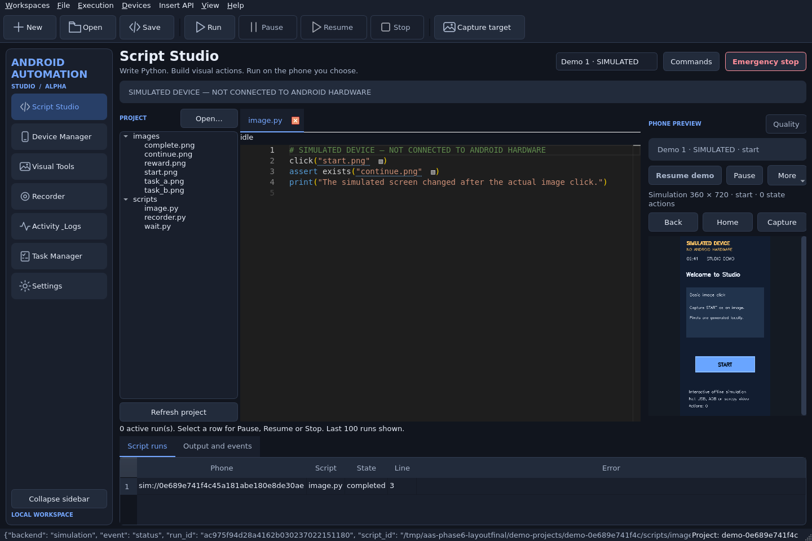
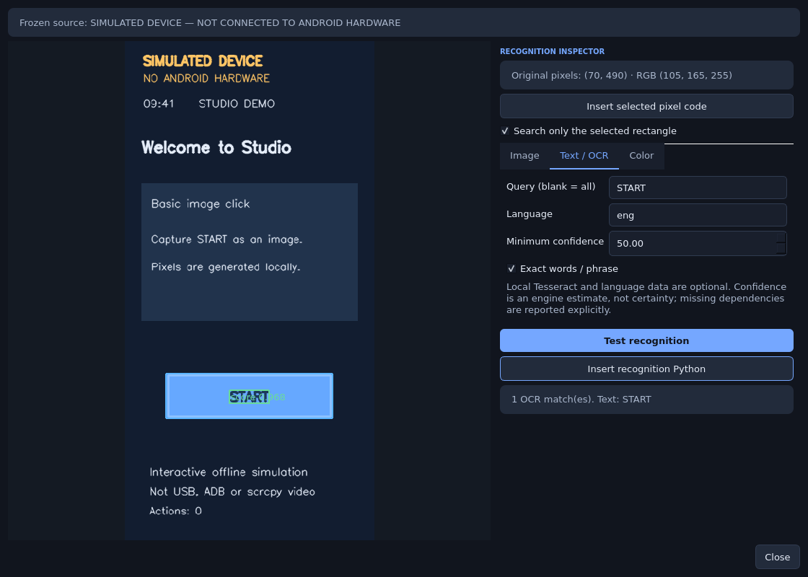
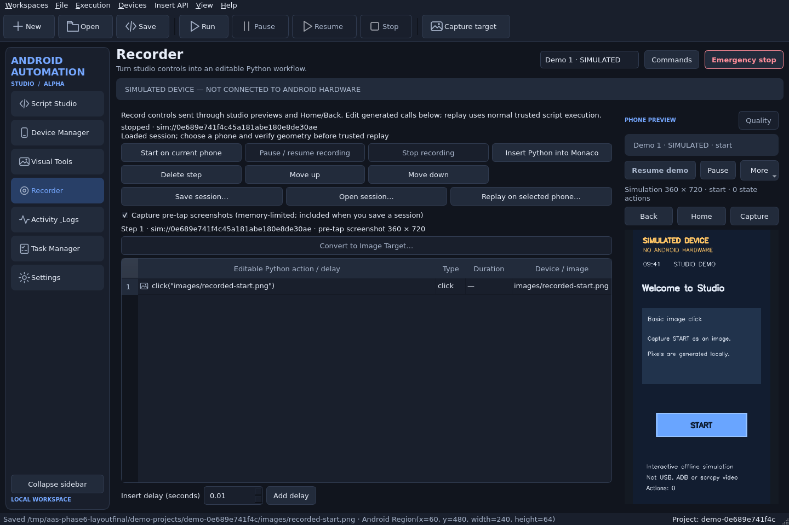
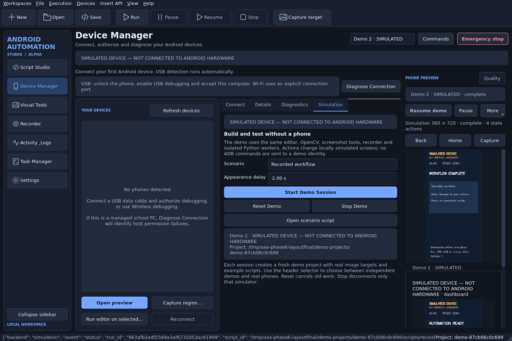

# Phase 6 simulation, recognition and recorder increment

Validated on 2026-10-30 in `/workspace/Bot_Frm`, Linux x86_64/glibc 2.41,
Python 3.12.14, PySide6 6.8.3, Monaco 0.52.2, OpenCV 4.11.0.86, NumPy 2.2.4,
PyAV 14.2.0 and actual Tesseract 5.5.0 (`eng`, `osd`). No package/model was
installed to enable OCR in this increment; the optional executable was already
available. The host was not Ubuntu 22.04 and was not Windows. No physical Android
phone was available. Simulation results below do not verify Android hardware.

## Delivered behavior

- **Offline simulation integrated into the application:** three interactive scenarios,
  actual state transitions, separate transport/capability identities, 360 × 720
  RGB captures, regular Qt previews, real OpenCV, Monaco, recording and spawned
  Python execution. Real ADB registry/discovery is unchanged. Start/Reset/Stop
  are explicit; reset/stop revoke old workers/clients and preserve saved projects.
- **Recognition:** optional real offline Tesseract extraction, word boxes/confidence,
  text/phrase search and cancellable waits; five new short/device commands (29
  public methods total), immutable device-bound text targets and editor catalog.
  Image preprocessing is explicit and defaults to unchanged RGB. Recognition
  Inspector tests image/text/color on frozen native/demo/local screenshots,
  shows actual overlays/original coordinates and inserts valid ordinary Python.
- **Recorder:** pre-tap PNG evidence with memory/file bounds, editable duration/type/
  device/image timeline metadata, evidence-preserving move/delete, v1-compatible
  JSON v2 sessions, geometry warnings and real crop/save conversion to image
  clicks/offsets. Conversion refuses absent evidence, invalid/constant/outside
  assets or changed rows/projects. Replay remains trusted isolated execution.
- **Small Phase 7 foundation:** typed failure advice plus safe source-snapshot
  navigation in Monaco, with automatic retry explicitly disabled. It does not
  implement DAP or breakpoint/step/stack/locals/console controls.
- **Preserved:** Python/PySide6 shell, Monaco/QWebChannel, native ADB/scrcpy 3.1,
  live-video decoder/transport, serial routing/generations, script tabs/imports,
  isolated workers, existing image APIs, source approval and emergency stop.

Bugs fixed while validating: OCR deadlines being misclassified as missing
executables (`TimeoutError` is an `OSError` subclass), preview controls clipped
by long simulation labels and overlapping compact tool/preview panes, virtual relative PySide dependency filenames being
reported as project execution lines, failure advice disappearing on refreshed
run rows, oversized generated recording/session input validation. All previous
620 baseline tests remain in the suite.

## Actual tests

Final full command (cloud headless flags only):

```bash
STUDIO_GUI_TESTS=1 QT_QPA_PLATFORM=offscreen \
QTWEBENGINE_DISABLE_SANDBOX=1 QTWEBENGINE_CHROMIUM_FLAGS=--disable-gpu \
STUDIO_CONFIG_DIR=/tmp/studio-phase6-layoutregression \
.venv/bin/python -m pytest -q
```

**687 passed in 42.74 seconds; 0 failed; 0 skipped.** Do not add the browser
sandbox flags to a normal desktop launcher. Initial focused checks exposed
failures in OCR timeout classification and new test assumptions; those were
corrected before this final result. Existing tests were preserved; the catalog
assertion was extended for the implemented Pattern builder.

| Evidence category | Actual scope |
| --- | --- |
| Unit + process/transport integration | 675 non-GUI tests in the full run, including existing ADB/socket/codec/runtime fixtures, matching, API and new simulator/OCR/recorder/recovery checks. These categories share the suite; not all 675 are unit tests. |
| Real Qt/Monaco integration | All 12 GUI-marked integration journeys passed. Real widgets, local WebEngine and WebChannel, visible clicks, source insertion, spawned processes and cleanup; synthetic sources for native-phone GUI checks. |
| Integrated demo journey | Visible Start Demo → actual script/image state change → image/color/OCR inspector → Monaco insertion → record tap/evidence → crop/save → converted Python → actual worker replay. Pause/resume, emergency stop/reset, two independent sessions, stop, strict no-ADB dispatch and source-linked failure inspection passed. |
| Simulation/backend integration | Stateful image/swipe/timer transitions, unique capabilities, ADB/registry rejection, two real spawned scripts, reset revocation, missing asset, timeout, pause and cancellation. GUI journey separately exercises the actual RuntimeService emergency latch. |
| OCR | Actual Tesseract extracted known text/boxes and cropped regions; API search/click/wait worked on known images; cancellation reaped the owned native child. Missing dependency, malformed TSV/options and oversized values covered. |
| Recorder | Ordering, tickets, edits, bounds, v1/v2 persistence, transactional invalid loads, original tap offsets, evidence ownership and GUI conversion/replay passed. |
| 125% rendering | Standalone complete `probe_phase6.py` with `QT_SCALE_FACTOR=1.25` passed on real offscreen Qt, including compact sizes, themes, normal workers, OCR, emergency stop and failure navigation. This is not Windows mixed-DPI validation. |
| Terminal examples | Retained `examples.run_visual_fixture` completed both mock styles; new `examples.run_simulation --scenario recorder` reached `complete`; `--scenario wait --delay .1` actually waited, matched and claimed the reward. |
| Real Android hardware | **Not run.** USB/Wi-Fi authorization, scrcpy on a phone, real touches/rotation and Android app behavior remain unverified. |
| Windows runtime | **Not run.** Source CI matrix retained/extended for the new branch/base, but no Actions success or Windows compatibility claim is made here. |

Reproduce the GUI journey directly with a fresh writable directory:

```bash
STUDIO_DATA_DIR=/tmp/aas-phase6-demo STUDIO_CONFIG_DIR=/tmp/aas-phase6-config \
QT_QPA_PLATFORM=offscreen QTWEBENGINE_DISABLE_SANDBOX=1 \
QTWEBENGINE_CHROMIUM_FLAGS=--disable-gpu \
.venv/bin/python tests/probe_phase6.py /tmp/aas-phase6-demo /tmp/aas-phase6-shots
```

Set `QT_SCALE_FACTOR=1.25` for the additional scaling run. The probe's rendered
PNG captures are real Qt screenshots, explicitly labeled simulation, not design
mockups. Normal desktop launch is `.venv/bin/python -m app.main` with none of
these headless flags. Use **Start Demo Session** (`Ctrl+Shift+D`); see
[Simulation](SIMULATION.md), [Recognition](RECOGNITION.md), [Recorder](RECORDER.md)
and [Local testing](LOCAL_TESTING.md).

## Rendered evidence

Reviewed actual screenshots for labels, readable controls and source/recognition
results. The review found and corrected preview clipping; original Alpha
screenshots/reports are retained. Compact layouts use the Preview toggle and
scroll areas where appropriate; they do not validate every native desktop/DPI
combination.






Additional light/compact/125% evidence is in [screenshots/phase6](screenshots/phase6).

## Performance observations

Short Linux fixture measurements, reproducible with
`.venv/bin/python tools/benchmark_recognition.py`; raw values and sample sizes:
[phase6-performance.json](validation/phase6-performance.json).

| Operation at 360 × 720 | Median / maximum |
| --- | --- |
| State DB read + render, 50 samples | 2.68 / 4.48 ms |
| PNG capture, 30 samples | 5.11 / 7.56 ms |
| Four simulator captures sequentially, 20 samples | 10.21 / 12.43 ms |
| RGB template search full screen, 30 samples | 12.45 / 17.64 ms |
| Same template in a 280 × 140 Region, 30 samples | 1.63 / 3.48 ms |
| Color search first 100 pixels, 30 samples | 7.99 / 12.74 ms |
| Local Tesseract button Region, 5 samples | 128.44 / 150.68 ms |

Benchmark parent RSS was about 51.3 MiB, excluding Qt/WebEngine/worker processes
(the benchmark is not the GUI). Standalone GUI creation-to-Monaco measured
963.1 ms at 100%, 944.0 ms at 125%; imports before window creation are excluded.
A 10 ms GUI heartbeat's largest observed gaps were 279.8/356.2 ms across the
scripted journeys, including startup, Qt screenshots, theme/resize work and
worker creation. This is a short responsiveness observation, not a frame-time
SLA. CPU percentage was unavailable on the first metrics sample and is recorded
as null. No sustained FPS, Android capture latency, aggregate process memory,
large-library or many-phone throughput guarantee is inferred.

## Limitations and remaining gates

Simulation is fixed-size local state, not Android emulation or video. APKs,
services, IME, sensors, physical touch timing/long-press semantics and rotation
are not emulated. OCR is optional local CPU work, supports installed languages
only, and has text/accuracy/search-area limits. Explicit image scales and
preprocessing do not make templates generally rotation/resolution independent.
Recorder conversion is for explicit short coordinate taps with pre-action
screenshots; no external-touch, curved/multitouch or automatic whole-workflow
conversion. The timeline has up/down ordering, not drag/drop. Debugger controls,
automatic safe retries/backoff, persistent history/failure screenshots, scheduler
and Windows packaging are deferred. Trusted scripts retain host-user permissions.

Next gates:

1. On the user's Ubuntu 22.04 x86_64 desktop, clone this feature branch into a
   fresh directory; follow [README_UBUNTU.md](../README_UBUNTU.md). Run all three
   integrated demos and optional local OCR without changing PC USB permissions.
2. On a host with permitted USB access, authorize two phones and record actual
   Android/ADB/server versions and geometry. Run independent video/previews and
   matching/taps per serial, rotate/change resolution, then disconnect/reset one
   while the other's worker continues. Confirm native screenshots/crops/OCR and
   recorder conversion/replay against the actual app screens.
3. Run native Windows 10/11 x64 acceptance and the CI matrix; test Tesseract
   executable/model paths with spaces, spawn/cleanup, WebEngine, USB drivers,
   compact and mixed-DPI layouts. Linux success is not Windows evidence.
4. Complete Phase 6 hardware/Windows and sustained-performance gates; then
   implement/validate private per-worker DAP, real breakpoints/steps/locals,
   bounded explicit recovery policies and later Beta gates. No installer yet.

## Git workflow

All implementation is on `feat/phase6-recognition-simulator`, based on
`fix/alpha-device-connect-and-ux-overhaul` at `7252f021e9aead0c7147ff2a6d535b5d3b9a6464`.
The stacked draft PR must target that branch. Main remains
`099cc2a2d72f4676e4ed616c1384daf2f6b36256`; previous feature remains
`a86c93193040ce004b1d6c5683b7def378865f7c`. No force-push, merge, branch deletion,
protection change or history rewrite is part of this delivery. The exact commit,
push/PR outcome and final worktree status are reported after publishing.

Prepared description: [PULL_REQUEST_PHASE6.md](PULL_REQUEST_PHASE6.md).
Compare: https://github.com/MD7-1337/Bot_Frm/compare/fix/alpha-device-connect-and-ux-overhaul...feat/phase6-recognition-simulator?expand=1

## File inventory

Existing files modified:

- `.github/workflows/alpha-tests.yml`
- `README.md`
- `README_UBUNTU.md`
- `app/automation/api/__init__.py`
- `app/automation/api/device.py`
- `app/automation/api/errors.py`
- `app/automation/api/models.py`
- `app/automation/qt_service.py`
- `app/automation/recording.py`
- `app/automation/runtime.py`
- `app/editor/catalog.py`
- `app/editor/widget.py`
- `app/main.py`
- `app/streaming/capture.py`
- `app/ui/capture_dialog.py`
- `app/ui/execution_panel.py`
- `app/ui/live_panel.py`
- `app/ui/preview.py`
- `app/ui/recorder_panel.py`
- `app/ui/settings_panel.py`
- `app/ui/shell.py`
- `app/ui/visual_tools.py`
- `app/ui/window.py`
- `app/vision/matching.py`
- `docs/LOCAL_TESTING.md`
- `docs/PHASES.md`
- `docs/SCRIPTING_API.md`
- `docs/VALIDATION.md`
- `tests/test_recording.py`
- `tests/test_scaled_recognition.py`
- `tests/test_script_editor.py`
- `tests/test_script_runtime.py`

New files created (including rendered evidence):

- `app/automation/recovery.py`
- `app/simulation/__init__.py`
- `app/simulation/model.py`
- `app/simulation/project.py`
- `app/simulation/transport.py`
- `app/ui/recognition_inspector.py`
- `app/ui/simulation_panel.py`
- `app/vision/ocr.py`
- `docs/DEBUGGING.md`
- `docs/PHASE6_VALIDATION.md`
- `docs/PULL_REQUEST_PHASE6.md`
- `docs/RECOGNITION.md`
- `docs/RECORDER.md`
- `docs/SIMULATION.md`
- `docs/screenshots/phase6/phase6-compact-125.png`
- `docs/screenshots/phase6/phase6-compact.png`
- `docs/screenshots/phase6/phase6-demo-studio.png`
- `docs/screenshots/phase6/phase6-devices-compact.png`
- `docs/screenshots/phase6/phase6-light.png`
- `docs/screenshots/phase6/phase6-recognition.png`
- `docs/screenshots/phase6/phase6-recorder-compact-125.png`
- `docs/screenshots/phase6/phase6-recorder-compact.png`
- `docs/screenshots/phase6/phase6-recorder.png`
- `docs/screenshots/phase6/phase6-simulation-controls.png`
- `docs/validation/phase6-performance.json`
- `examples/recognition_script.py`
- `examples/run_simulation.py`
- `tests/probe_phase6.py`
- `tests/test_ocr.py`
- `tests/test_phase6_gui.py`
- `tests/test_recovery.py`
- `tests/test_simulation.py`
- `tools/benchmark_recognition.py`
