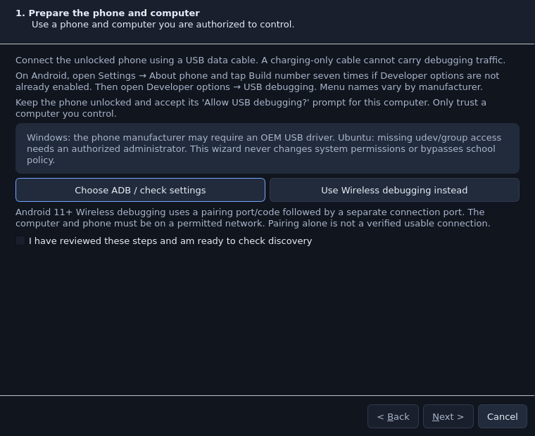

# Real Android acceptance on another computer

**Cloud hardware status: NOT VERIFIED.** No phone is attached to the cloud build
machine. Passing Demo Mode, source or packaged simulator tests is separate from
the physical-phone results below. The restricted school computer is not required
for development or acceptance; use an authorized Windows 10/11 x64 or Ubuntu
22.04+ computer with working USB access and a phone you may control.

## Prepare the application and test content

1. Obtain the actual packaged artifact and SHA-256 listed in
   [RELEASE_VALIDATION.md](RELEASE_VALIDATION.md). Verify the download before
   extracting it. Windows PowerShell: `Get-FileHash .\download.zip -Algorithm SHA256`.
   Ubuntu: `sha256sum download.tar.gz`. Compare the complete digest.
2. Extract to a user-owned folder, including a folder name with spaces for the
   path test. Launch the packaged executable/launcher from that extracted folder.
   Do not launch from inside the archive, a source checkout or another project's
   virtual environment. Normal startup uses your own user account without sudo.
3. In Settings, run dependency health. Monaco must become ready offline and
   **Start Demo Session** must work before connecting a phone. A missing optional
   OCR engine does not prevent image/color recognition or Demo Mode.
4. Choose the intended local ADB executable and matching scrcpy 3.1 server in
   Settings if they are not supplied by that artifact. Missing Android tools
   remain a real diagnostic error; they are not silently downloaded or replaced.
5. Prepare an expendable test application or consented test content with known
   visual buttons/counters. Avoid payments, messages, account changes or personal
   applications. An already-dispatched touch cannot be undone by Emergency stop.

Record the artifact filename/checksum/commit, OS version, CPU/RAM, display scale,
phone model/Android version, ADB version, scrcpy server version and USB/Wi-Fi mode.
Keep private serials and screen content out of publicly shared reports.

## Connect with the wizard

Open **Device Manager → Connection wizard…**. The wizard is modeless, so the
workbench and preview remain accessible behind it.

1. Use a data-capable USB cable, unlock the phone, enable Developer options and
   USB debugging, and accept the computer authorization prompt on the phone.
   The first page acknowledges that you have reviewed these steps; it is not a
   claim that a phone was detected.
2. Refresh discovery and choose the exact real device serial/model. Unauthorized,
   offline and no-permissions states have distinct guidance. Simulated devices
   are excluded from this wizard. An authorized ADB row permits diagnostics but
   does not count as a verified Android query.
3. Run connection diagnostics. Continue only after the current connection passes
   a harmless serial-specific Android query. A report from an old selection or
   connection generation cannot satisfy this check. Later screenshot/video
   failures remain visible as failures/NOT VERIFIED stages.
4. Open a live preview. Finishing requires a fresh decoded real-device frame;
   an ADB screenshot or Demo frame is not a video pass. Inspect moving content on
   the physical phone and the preview. Optional **Test Home** is a separate,
   explicit serial-specific input request; inspect the phone to judge its result.

**Windows:** install the manufacturer's supported USB driver when required.
Verify the cable/data mode and Device Manager before blaming an empty ADB list
on the studio. **Ubuntu:** missing udev rules/group access or school USB policy
must be handled by the authorized host administrator; the application does not
bypass permission checks or change system security.

For Android 11+ Wireless debugging, use Device Manager's Pair with the pairing
port/code, then Connect with the separate connection port. Pairing is not itself
a usable connection test. Use only networks where peer traffic and debugging are
permitted. No pairing code should appear in history or exported diagnostics.

## One-phone result sheet

Replace **NOT VERIFIED** with **PASS** or **FAIL** only after executing that row
on the stated artifact/machine. Record the observed result and any error text.

| Step | Action and expected observation | Result |
| --- | --- | --- |
| 1 | Launch the extracted package; Monaco is ready and local project files open. | NOT VERIFIED |
| 2 | Dependency health identifies actual tools/libraries and optional OCR state. | NOT VERIFIED |
| 3 | USB phone appears with the correct serial/model; authorization is explicit. | NOT VERIFIED |
| 4 | Diagnostics passes the exact-device query and fully decoded original PNG. | NOT VERIFIED |
| 5 | scrcpy preview receives moving real frames, separately from screenshot fallback. | NOT VERIFIED |
| 6 | An explicit tap on the test application's known button produces its expected counter change. | NOT VERIFIED |
| 7 | A bounded swipe moves the test content; Home/Back affect only this phone. | NOT VERIFIED |
| 8 | Rotation/resolution changes preserve coordinate mapping; letterboxes reject input. | NOT VERIFIED |
| 9 | Capture/crop/save an image under the project; saved PNG has original-screen geometry. | NOT VERIFIED |
| 10 | Insert target Python in Monaco; Test Match on a fresh capture returns expected region/score without a tap. | NOT VERIFIED |
| 11 | Run the approved image click once on test content; inspect the actual screen result. | NOT VERIFIED |
| 12 | Pause/resume acknowledge safe points; Stop ends the owned worker. | NOT VERIFIED |
| 13 | Set a breakpoint, inspect locals/stack, step and continue; later edits stay intact. | NOT VERIFIED |
| 14 | Record studio controls, pause/stop, edit/reorder, save/reopen, and replay the approved Python. | NOT VERIFIED |
| 15 | Convert a recorded coordinate tap using its real pre-tap evidence; replay the image target. | NOT VERIFIED |
| 16 | Schedule one approved bounded task; history, source/device and result agree. | NOT VERIFIED |
| 17 | Force a missing target/timeout; inspect failure category, traceback and optional fresh post-failure screenshot. | NOT VERIFIED |
| 18 | Emergency stop running and paused work; new inputs stay blocked until reset. | NOT VERIFIED |
| 19 | Unplug during wait/input/debug; reconnect does not replay old work or retain old task approval. | NOT VERIFIED |
| 20 | Save/export/restore project data and recording; restart and inspect source, assets and task history. | NOT VERIFIED |
| 21 | Close/reopen repeatedly; no owned worker/video process remains after clean shutdown. | NOT VERIFIED |

## Two-phone result sheet

Label the phones A and B locally. Verify each serial before every run and use
visually distinguishable test screens. Never infer routing merely from row order.

| Action and expected observation | Result |
| --- | --- |
| Both phones discovered and independently authorized; previews match their physical screens. | NOT VERIFIED |
| Assign different scripts; two independent workers change only their intended test screens. | NOT VERIFIED |
| Pause/debug A; B continues and the GUI remains responsive. | NOT VERIFIED |
| Fail recognition on A; B remains running and its logs/targets remain separate. | NOT VERIFIED |
| Disconnect A; only A's generation/queued operations become obsolete. | NOT VERIFIED |
| Reconnect A; no automatic resume/replay occurs, and new task approval is required. | NOT VERIFIED |
| Queue incompatible work on one phone; its per-device lease prevents simultaneous control. | NOT VERIFIED |
| Cancel a pending workflow/group; no later member is dispatched after cancellation. | NOT VERIFIED |
| Emergency stop cancels both running/paused workers and prevents queued dispatch. | NOT VERIFIED |
| Close the application; both owned video/worker lifecycles clean up. | NOT VERIFIED |

## Platform and diagnostics checks

On Windows test 100%/125% scaling, changed monitor layouts, paths with spaces,
OEM driver differences, portable relocation and user-data preservation during
installer upgrade/uninstall. On Ubuntu record desktop session, Qt/WebEngine
native library availability, USB access and the package's documented glibc
baseline. Never turn off WebEngine sandbox protections as a normal startup fix.

In **Device Manager → Diagnostics**, run the real check, then use **Copy Diagnostic
Report** or **Export Diagnostics…**. Device serial redaction is enabled by
default, home paths are shortened, pairing codes are scrubbed and screen pixels
are omitted. Review host/path details before sharing. Raw discovery can prove
that the host sees nothing, an unauthorized phone, an offline phone or a USB
permission error; it cannot by itself prove a missing driver versus a bad cable.

For a bug report include artifact/checksum/commit, PASS/FAIL/NOT VERIFIED row,
short exact reproduction, expected/actual observations, redacted diagnostic text,
and relevant logs. Share screenshots only when you have reviewed their private
content. Keep Windows, Ubuntu, one-phone and two-phone outcomes separate.
